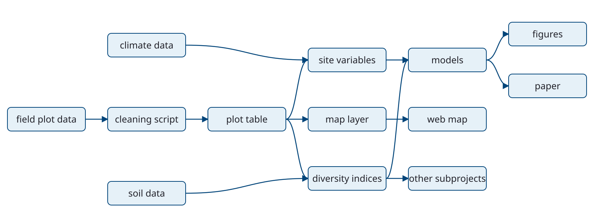
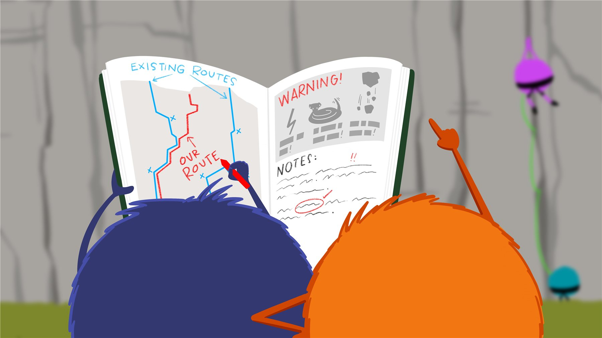
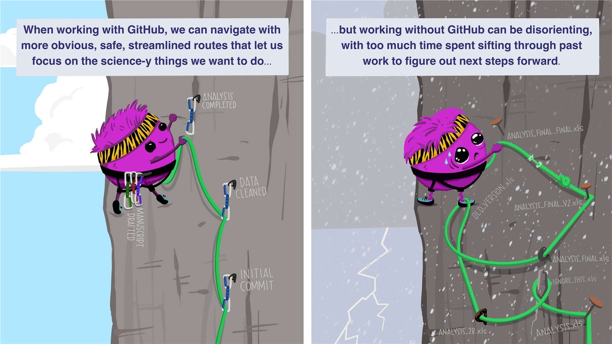
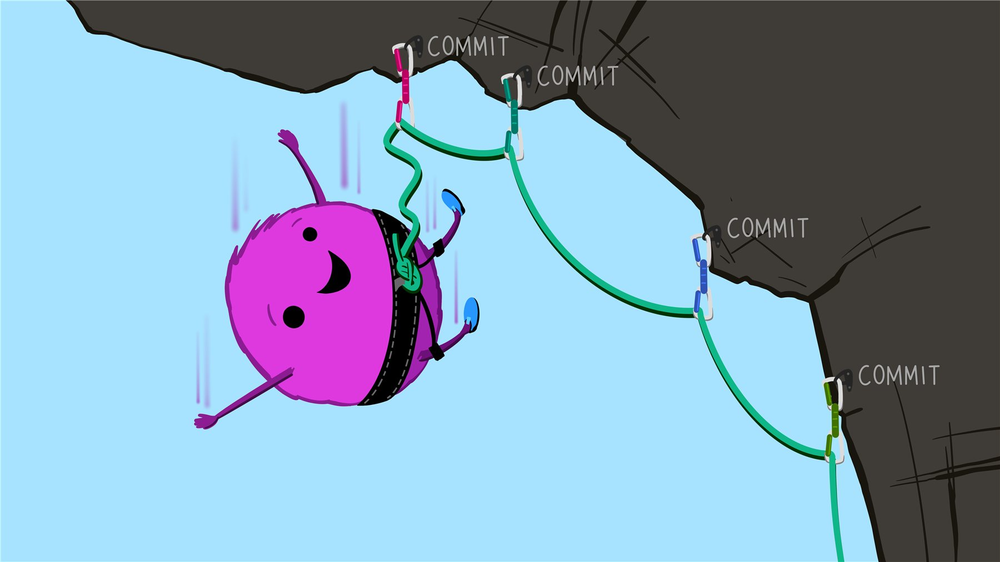
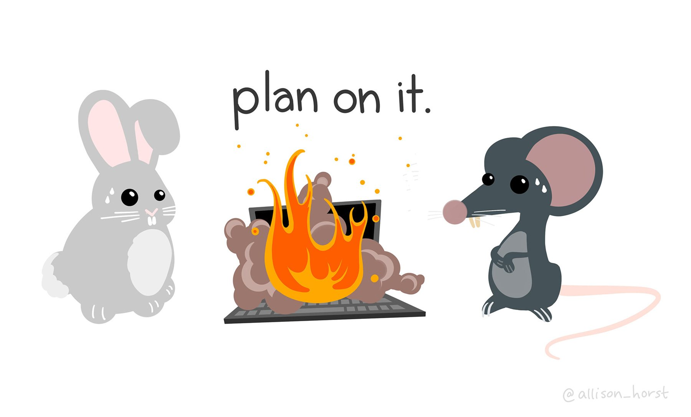
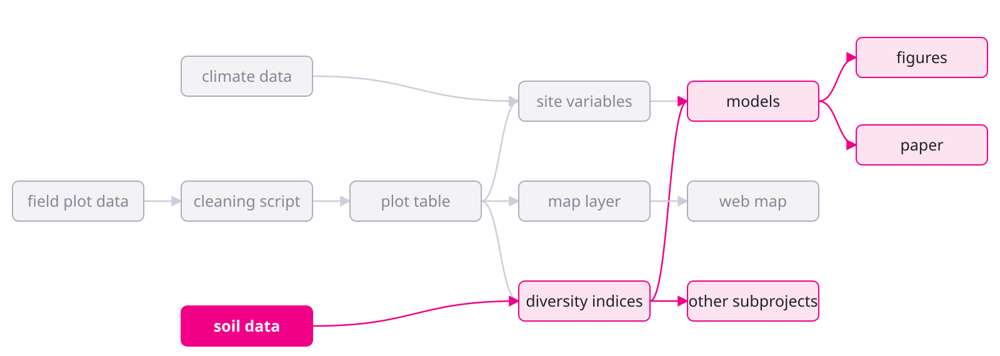
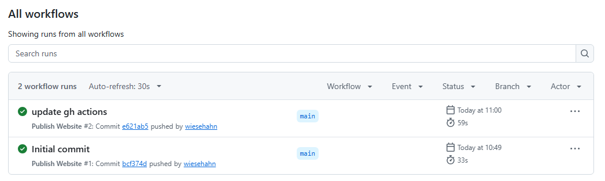

---
title-slide-attributes:
  data-background-image: images/presentation_title_image.png
  data-background-size: contain
  data-background-position: bottom
  data-background-color: "#ffffff"
nocite: |
  @Horst_artwork
---

## One change, many consequences

::: {.question}
What happens if one value changes at the very start?
:::

::: {.r-stack}
{fig-alt="A branching data pipeline from field plot data to figures, paper, web map and other subprojects" width="1500px"}

{.fragment fig-alt="The same pipeline with every step downstream of the field data highlighted in pink" width="1500px"}
:::

::: notes
~1.5 min. Hypothetical example: one field plot has to be relocated (site too steep), so its coordinates change.
First show the pipeline, then reveal: everything downstream is affected, figures, paper, map, other subprojects.
Who knows which results already used the old value? Can we tell what changed, when, and why?
:::

## Reproducibility is a spectrum

::: {.question}
Same data + same code → same result?
:::

:::: {.columns}
::: {.column width="45%"}
Reproducibility is **not all-or-nothing**.

Every step helps:

README · git · recorded versions · pipeline · DOI

<br>

[Small steps make your work easier to rerun, check and reuse, for colleagues and for future you.]{.second-color}

<br>

Who has a file called `final_v3`?
:::

::: {.column width="55%"}
{fig-alt="Cartoon: a monster judge in the reproducibility court, an R Markdown document as exhibit A"}
:::
::::

::: {.attribution}
Artwork by [Allison Horst](https://allisonhorst.com), CC-BY 4.0
:::

::: notes
~1 min. Show of hands for final_v3. No shame: everyone starts there.
Today: five steps, each useful on its own. Pick the next one that fits you.
:::


# 1 · Organise {background-color="#02457a"}

## One project, one folder {auto-animate="true"}

::: {.question}
Which file is the current one?
:::

```{.default}
my-project/
├── plots.csv
├── plots_final.csv
├── plots_final_v3_corrected.csv
├── analysis.R
├── analysis_NEW.R
├── analysis_NEW_2.R
├── map.png
└── map_old.png
```

::: notes
~30 s. Recognisable? Which one is current?
:::

## One project, one folder {auto-animate="true"}

::: {.question}
Which file is the current one?
:::

:::: {.columns}
::: {.column width="42%"}
```{.default}
diversa-plots/
├── README.md
├── data-raw/   # original
│   └── plots_field_2025.csv
├── data/       # from scripts
├── R/
│   ├── 01_clean_plots.R
│   ├── 02_export.R
│   └── 03_site_vars.R
├── output/     # results
└── _targets.R
```
:::

::: {.column width="58%"}
{fig-alt="Sketch: raw data kept raw, organised wrangling, open analyses, reproducible outputs, backed up with version control" .lightbox}
:::
::::

::: {.attribution}
Artwork by [Allison Horst](https://allisonhorst.com), CC-BY 4.0
:::

::: notes
~1 min. Separate raw data, processed data, code and outputs.
Anything in data/ and output/ can be deleted and recreated by the scripts.
Inspired by Wilson et al. 2017 "Good enough practices".
:::

## Raw data stays untouched

::: {.question}
How do you correct an error in raw data?
:::

[Correct in code, not in the file.]{.second-color}

```{.r filename="R/01_clean_plots.R" code-line-numbers="|1|3-5|7"}
plots <- read.csv("data-raw/plots_field_2025.csv")

# Plot 17 relocated: original site too steep for measurements.
# Re-measured 2026-05-12, see field protocol 42.
plots[plots$plot_id == 17, c("x", "y")] <- c(562520, 5813295)

write.csv(plots, "data/plots.csv", row.names = FALSE)
```

::: notes
~1 min. Step through: read the raw file, fix with explanation, write the processed file.
The raw field file is never edited by hand. Same idea in Python or any other language.
:::

## Document for future you

::: {.question}
Would a new colleague understand your project?
:::

:::: {.columns}
::: {.column width="48%"}
**Best practices**

- plain text / Markdown
- next to the data and code
- updated together with the code
- written for someone new

**README essentials**

| | |
|---|---|
| Purpose | what is this? |
| Structure | what is where? |
| How to run | which script first? |
| Data sources | where from, licence? |
| Contact | who to ask? |

 guide & template: [makeareadme.com](https://www.makeareadme.com)
:::

::: {.column width="52%"}
{fig-alt="Two monsters reading a climbing guide book with existing routes, warnings and notes" .lightbox}
:::
::::

::: {.attribution}
Artwork by [Allison Horst](https://allisonhorst.com) for Openscapes, CC-BY 4.0
:::

::: notes
~1 min. The most important collaborator is you in six months.
A README is like a climbing guide: routes, warnings, notes. GitHub shows it automatically.
:::

## Describe your data

::: {.question}
What does `x` mean here, and what is `NA`?
:::

| column | description | type | unit | allowed values | missing |
|---|---|---|---|---|---|
| `plot_id` | plot identifier | integer | – | unique | – |
| `x`, `y` | plot centre | number | m, EPSG:25832 | – | `NA` |
| `forest_type` | dominant tree species | text | – | beech, spruce, oak, pine | `NA` |
| `management` | management status | text | – | managed, unmanaged | `NA` |

<br>

[A data dictionary answers questions before they are asked.]{.second-color}

::: notes
~1 min. Type, unit, allowed values and missing-value codes are the classic gaps.
Can live in the README or as a separate CSV file.
:::

## Relative paths, not absolute {auto-animate="true"}

::: {.question}
Does your code run on a colleague's computer?
:::

:::: {.columns}
::: {.column width="45%"}
```{.default}
C:/Users/me/Documents/
  DIVERSA/final/
  plots_final_v3_corrected.csv
```
:::

::: {.column width="55%"}
{fig-alt="A cartoon of a cracked glass cube looking frustrated with casts on its arm and leg, with bandaids on it, containing setwd, looks on at a metal riveted cube labeled R Proj holding a skateboard looking sympathetic, and a smaller cube with a helmet on labeled here doing a trick on a skateboard."}
:::
::::

::: {.attribution}
Artwork by [Allison Horst](https://allisonhorst.com), CC-BY 4.0
:::

::: notes
~15 s. This path exists on exactly one computer.
:::

## Relative paths, not absolute {auto-animate="true"}

::: {.question}
Does your code run on a colleague's computer?
:::

:::: {.columns}
::: {.column width="45%"}
```{.default}
data/plots.csv
```

- paths start at the **project folder**
- open the project as a whole: RStudio project, VS Code folder, …
- works on every computer, in any language
:::

::: {.column width="55%"}
{fig-alt="A cartoon of a cracked glass cube looking frustrated with casts on its arm and leg, with bandaids on it, containing setwd, looks on at a metal riveted cube labeled R Proj holding a skateboard looking sympathetic, and a smaller cube with a helmet on labeled here doing a trick on a skateboard."}
:::
::::

::: {.attribution}
Artwork by [Allison Horst](https://allisonhorst.com), CC-BY 4.0
:::

::: notes
~45 s. Opening the project sets the working directory to the project root.
R users: avoid setwd(); for Quarto files in subfolders here::here() helps.
:::


# 2 · Track {background-color="#02457a"}

## Why git?

::: {.question}
Which version did I send to the other subproject?
:::

**history** · **undo** · **compare** · **why**

{.r-stretch fig-alt="Two climbing panels: with version control a clear route with commits, without it a tangle of analysis_final_final.xls files" .lightbox}

::: {.attribution}
Artwork by [Allison Horst](https://allisonhorst.com) for Openscapes, CC-BY 4.0
:::

::: notes
~1 min. git is a program on your own computer, it works offline and privately.
One file name, every version inside git. No more final_v3.
:::

## A commit is a save point with a message

::: {.question}
What changed, when, and why?
:::

:::: {.columns}
::: {.column width="42%"}
```{.default}
a3f9c21  Move plot 17: too steep
7be01d4  Fix species codes
1c2e8f0  Add plot sites 2025
```

<br>

[You decide **when** to save and **what** to say.]{.second-color}
:::

::: {.column width="58%"}
{fig-alt="A climbing monster falls but is caught by the rope clipped into commits" .lightbox}
:::
::::

::: {.attribution}
Artwork by [Allison Horst](https://allisonhorst.com) for Openscapes, CC-BY 4.0
:::

::: notes
~1 min. Each line is a snapshot of the whole project with an ID, author, date and message.
Like protection points in climbing: if something goes wrong, you only fall back to the last commit.
Write messages that say why.
:::

## See exactly what changed {auto-animate="true"}

::: {.question}
What changed, when, and why?
:::

```{=html}
<div class="diffview">
<div class="fname">data/plots.csv</div>
<div class="line" data-id="l0">  plot_id,x,y,forest_type,management</div>
<div class="line" data-id="l1">  16,561870,5813015,beech,unmanaged</div>
<div class="line" data-id="l2">  17,562455,5813410,spruce,managed</div>
<div class="line" data-id="l3">  18,563102,5812877,oak,unmanaged</div>
</div>
```

::: notes
~15 s. The processed plot table before the change.
:::

## See exactly what changed {auto-animate="true"}

::: {.question}
What changed, when, and why?
:::

```{=html}
<div class="diffview">
<div class="fname">data/plots.csv</div>
<div class="line" data-id="l0">  plot_id,x,y,forest_type,management</div>
<div class="line" data-id="l1">  16,561870,5813015,beech,unmanaged</div>
<div class="line del" data-id="l2">- 17,562455,5813410,spruce,managed</div>
<div class="line add" data-id="l2b">+ 17,562520,5813295,spruce,managed</div>
<div class="line" data-id="l3">  18,563102,5812877,oak,unmanaged</div>
</div>
```

<br>

`a3f9c21` · Jens · 2026-05-12 · *Move plot 17: original site too steep*

::: notes
~1 min. After rerunning the script git shows exactly this line changed: old in pink, new in green, plus who, when and why.
Works for code and text-based data (CSV, GeoJSON), not for Excel or binary files.
:::

## Why add a remote?

::: {.question}
What if your laptop dies tomorrow?
:::

:::: {.columns}
::: {.column width="42%"}
git works locally, a remote is **optional**.

::: {.fragment fragment-index=1}
- **backup**: off your laptop
:::

::: {.fragment fragment-index=2}
- **collaboration**: one shared history
:::

::: {.fragment fragment-index=3}
- **sharing**: one link for everything
:::

<br>

 **private**: only you, or your team

 **public**: open, route to publication
:::

::: {.column width="58%"}
::: {.r-stack}
{fig-alt="A bunny and a mouse, both looking stressed and sweaty, look on at a smoking laptop as flames start to grow from it. Text reads: plan on it."}

{.fragment fragment-index=2 fig-alt="A row of 6 cute smiling monsters celebrating using GitHub. The first, wearing a climbing harness labeled Me, is high-fiving another whose harness says Future Me. Others hold a box of snacks that are tacos, a map, and a rope. Text above the monsters quotes Jenny Bryan: Collaboration is the most compelling reason to manage a project with Git and GitHub. My definition of collaboration includes hands-on participation by multiple people, including your past and future self, as well as an asymmetric model, in which some people are active makers and others only read or review."}
:::
:::
::::

::: {.attribution}
Artwork by [Allison Horst](https://allisonhorst.com) (partly for Openscapes), CC-BY 4.0
:::

::: notes
~1 min. Collaboration includes your past and future self.
Start private if unsure, make public when publishing.
.gitignore keeps large or sensitive files (e.g. audio recordings, passwords) out of git.
:::

## Where to host

::: {.question}
Where should the remote live?
:::

:::: {.columns}
::: {.column width="33%"}
###  GitHub

most widespread, used here
:::

::: {.column width="33%"}
###  GitLab

institutional instances, e.g. [git.nw-fva.de](https://git.nw-fva.de)
:::

::: {.column width="33%"}
###  Codeberg

non-profit, EU-based, [codeberg.org](https://codeberg.org)
:::
::::

<br>

[Same git everywhere: switching hosts is easy.]{.second-color}

::: notes
~30 s. Institutional GitLab is often not accessible for external partners, so check access first.
:::

## The daily loop

::: {.question}
How does a change get from my folder to GitHub?
:::

{fig-alt="Diagram: working folder, add, staging area, commit, local repository, push, remote repository, pull back to working folder" width="1500px"}

[In RStudio and VS Code these are buttons.]{.second-color}

::: notes
~1.5 min. add: choose which changes go into the next save point. commit: save them with a message.
push: upload to GitHub. pull: get your colleagues' changes.
Without a remote, only add and commit, all local.
:::

## No terminal needed

::: {.question}
Do I need the command line?
:::

:::: {.columns}
::: {.column width="40%"}
VS Code, Source Control view:

1. **+** stages a changed file
2. write a message
3. **Commit**
4. **Sync** = pull + push

<br>

RStudio: same in the *Git* pane.
:::

::: {.column width="60%"}
{fig-alt="VS Code Source Control view with a commit message box, Commit button, staged changes and the Stage Changes button" width="100%" .lightbox}
:::
::::

::: {.attribution}
Screenshot: [VS Code docs](https://code.visualstudio.com/docs/sourcecontrol/staging-commits), CC BY 3.0 US
:::

::: notes
~1 min. Checkboxes or plus buttons = add, button = commit, arrows / sync = pull and push.
Setup help: Happy Git and GitHub for the useR.
:::

## Explore a real repository

::: {.question}
What does this look like in practice?
:::

:::: {.columns}
::: {.column width="60%"}
[**r-spatial/sf**](https://github.com/r-spatial/sf): simple features for R

- **commits** & history
- **blame**: who changed which line
- **issues**: questions, bugs, ideas
- **pull requests**: proposed changes
- **branches** & **releases**
- **Actions**: automatic checks
:::

::: {.column width="40%"}

:::
::::

::: notes
~2 min. Switch to the browser and walk through sf. Audience may follow on their phones or laptops.
Many contributors, active issues and PRs, releases on CRAN, checks on every push.
:::


# 3 · Record {background-color="#02457a"}

## "Works on my machine"

::: {.question}
Will your code still run next year?
:::

[Package versions change, and results with them.]{.second-color}

<br>

::: {.incremental}
- **minimum**: list software and package versions in the README
- **R**: `sessionInfo()`, better `renv` (`renv::init()`, `renv::snapshot()`)
- commit the lock file (`renv.lock`) to git
- **this presentation**: Quarto version pinned in the GitHub workflow
:::

::: notes
~2 min. Same idea in Python: requirements.txt or environment.yml.
renv records exact versions per project, others restore them with renv::restore().
Containers (Docker) go one step further, not needed for most projects.
:::


# 4 · Automate {background-color="#02457a"}

## What do I rerun?

::: {.question}
Which scripts do I need to rerun after a change?
:::

{fig-alt="The pipeline with every step downstream of the field data highlighted" width="1500px"}

::: notes
~1 min. Callback to the opening: every pink box is outdated. Doing this by hand means forgetting a step.
:::

## Write the pipeline down

::: {.question}
Who knows the order of the steps?
:::

:::: {.columns}
::: {.column width="40%"}
**Script list**

```{.r filename="run_all.R"}
source("R/01_clean_plots.R")
source("R/02_read_soil.R")
source("R/03_diversity.R")
source("R/04_model.R")
```

*You* keep the order, everything reruns.
:::

::: {.column width="60%"}
**Pipeline**

```{.r filename="_targets.R"}
list(
  tar_target(plots, clean(raw)),
  tar_target(soil, read_soil(f)),
  tar_target(div, calc_div(plots, soil)),
  tar_target(model, fit(div))
)
```

The tool knows the order, only changes rerun.
:::
::::

`targets::tar_make()` · [same idea in other languages: Make, Snakemake]{.third-color}

::: notes
~1.5 min. Left: works, but you must remember the order and you rerun everything.
Right: each step names its inputs, so targets knows the order and what is outdated.
:::

## Only rerun what changed

::: {.question}
Do I have to rerun everything?
:::

{fig-alt="Pipeline where soil data changed: only diversity indices, models, figures, paper and other subprojects are rerun, all other steps are skipped" width="1500px"}

::: {.legend}
[]{.box style="background:#f10087;border-color:#f10087"} changed [ ]{.box style="background:#fde3f0;border-color:#f10087"} rerun [ ]{.box style="background:#f3f3f6;border-color:#adadbd"} up to date, skipped
:::

::: notes
~1 min. targets remembers what it built. If only the soil data changes, only the steps downstream of it run again.
Saves hours for slow models.
:::

## Let GitHub do it

::: {.question}
Can the rebuild happen automatically?
:::

{fig-alt="GitHub Actions page of this repository with two successful Publish Website runs" width="100%" .lightbox}

:::: {.columns}
::: {.column width="50%"}
```{.yaml filename="publish.yml"}
on:
  push:
    branches: main
steps:
  - run: quarto render
  - uses: deploy-pages
```
:::

::: {.column width="50%"}
<br>

Every push rebuilds and publishes these slides.
:::
::::

::: notes
~1.5 min. GitHub Actions run on every push: render, test, publish.
Another example: the diversa-map is deployed the same way.
:::


# 5 · Publish {background-color="#02457a"}

## FAIR in one slide

::: {.question}
What makes data and code reusable?
:::

| | | |
|---|---|---|
| **F**indable | DOI, metadata | Zenodo record |
| **A**ccessible | open, standard protocol | public repository |
| **I**nteroperable | open formats, vocabularies | CSV, GeoPackage |
| **R**eusable | licence, documentation | README, data dictionary |

::: notes
~1 min. Skip if covered in the research data management talks.
Most of this follows from the earlier steps: README, data dictionary, open formats.
:::

## No licence, no reuse

::: {.question}
May others reuse your code and data?
:::

**code**: MIT

**data**: CC-BY 4.0

<br>

[No licence = all rights reserved.]{.second-color}

<br>

[choosealicense.com](https://choosealicense.com)

::: notes
~1 min. A public repo without a licence legally cannot be reused. Add a LICENSE file.
The further up, the easier the reuse. CC-BY only asks for credit.
:::

## Get a DOI for your code

::: {.question}
How do others cite your code?
:::

::: {.incremental}
1. connect GitHub to [Zenodo](https://zenodo.org) (once)
2. create a release on GitHub (`v1.0`)
3. Zenodo archives it and mints a DOI
:::

::: {.callout-note}
TODO: screenshot of a Zenodo record `images/screenshots/zenodo-record.png`
:::

::: notes
~1 min. Zenodo is run by CERN, free and long-term. A DOI makes code citable like a paper.
:::

## Cite the version you used

::: {.question}
Which version did you use?
:::

| release | plot 17 | DOI |
|---|---|---|
| `v1.0` | old position | 10.5281/zenodo.xxxxxx1 |
| `v1.1` | corrected | 10.5281/zenodo.xxxxxx2 |
| *all versions* | – | *concept DOI* |

<br>

`CITATION.cff` → GitHub shows a **Cite this repository** button

::: notes
~1.5 min. Each release gets its own DOI, the concept DOI always resolves to the latest.
Colleagues cite exactly the version they used, so results stay traceable.
:::


# Back to the start {background-color="#02457a"}

## Back to the start

::: {.question}
What happens if one value changes at the very start?
:::

::: {.incremental}
- **what** changed → diff
- **why** → commit message
- **rerun** → pipeline (`tar_make()`)
- **cite** → `v1.1` DOI
:::

::: notes
~1 min. The questions from the beginning are now answered by the workflow itself.
:::

## Pick one next step

::: {.question}
Where do I start?
:::

| step | try this |
|---|---|
| 1 · Organise | write a README |
| 2 · Track | `git init` + a GitHub repository |
| 3 · Record | note your package versions |
| 4 · Automate | describe your steps as a pipeline |
| 5 · Publish | a release on Zenodo |

::: notes
~1 min. Not everything at once. One step this month.
:::

## Learn more

- [The Turing Way](https://the-turing-way.netlify.app) [@TuringWay_2022]
- [Happy Git and GitHub for the useR](https://happygitwithr.com) [@Bryan_HappyGit]
- [GitHub Skills](https://learn.github.com/skills): interactive git & GitHub courses
- [Quarto: get started with RStudio](https://quarto.org/docs/get-started/computations/rstudio)
- [targets manual](https://books.ropensci.org/targets/)

::: notes
~30 s. You are not alone: lots of good material and people to ask.
:::


# Thank you {visibility="uncounted"}

<br>

:::: {.columns}
::: {.column width="70%"}

Questions?

<br>

 *[](mailto:)*

 *[](https://elk.zone/fosstodon.org/@JensWiesehahn)*

:::

::: {.column width="30%"}
Slides available at:

[]()

<br>


:::
::::


# References {visibility="uncounted"}

::: {#refs}
:::
