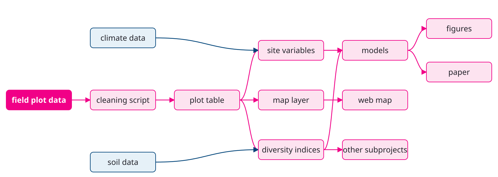
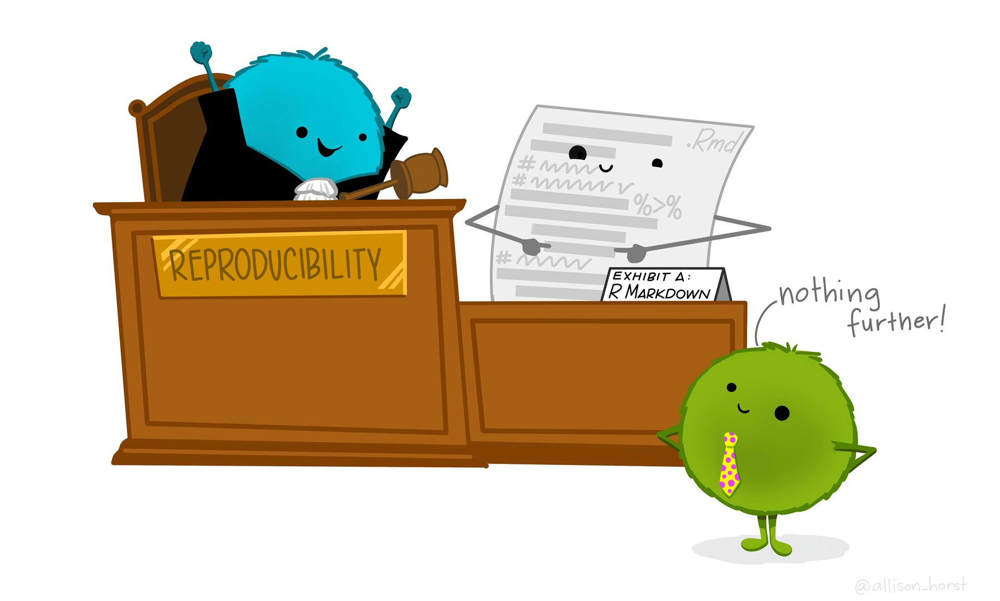
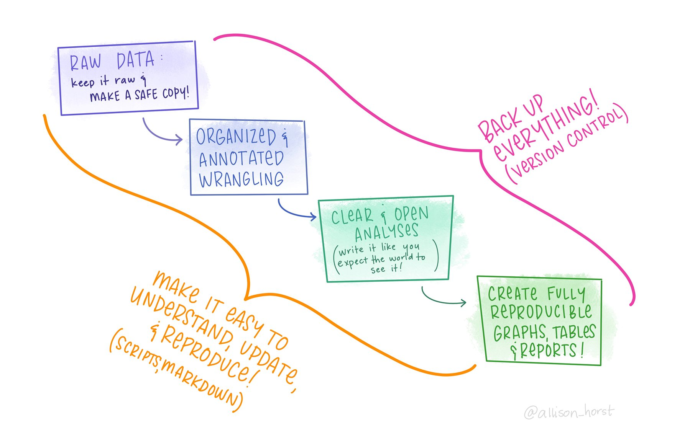
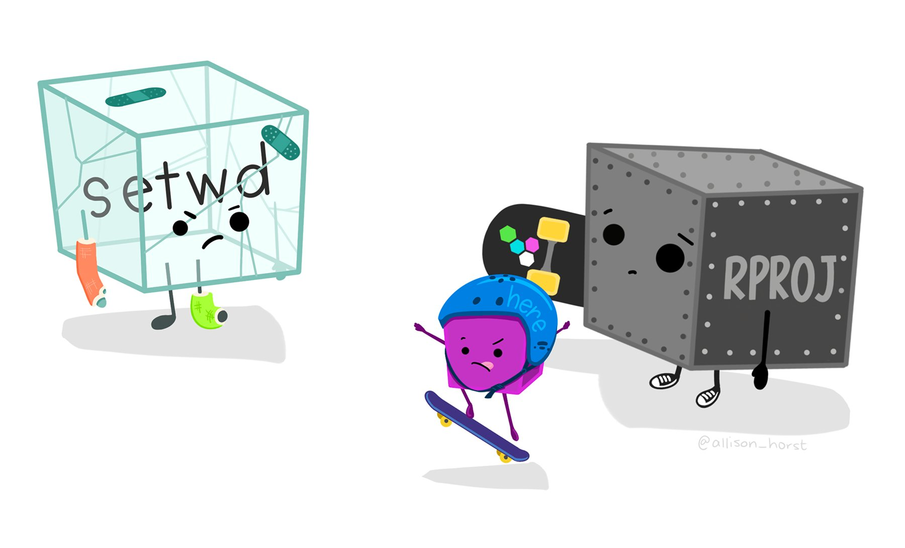
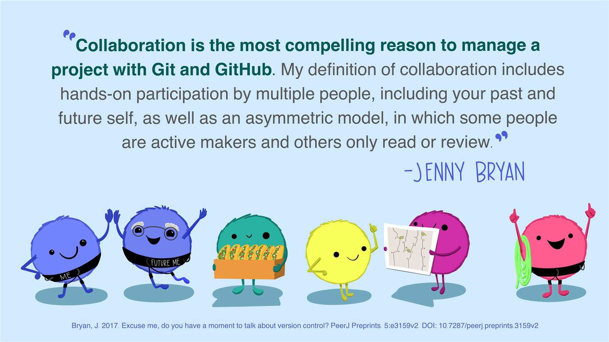
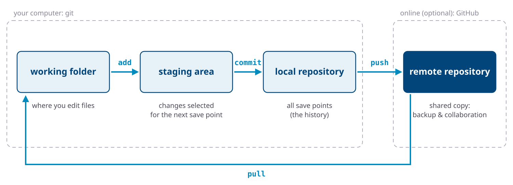
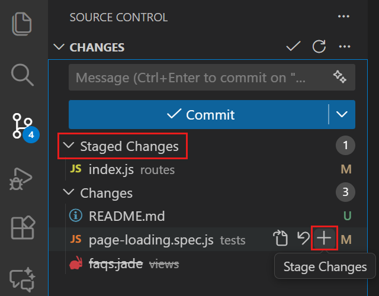
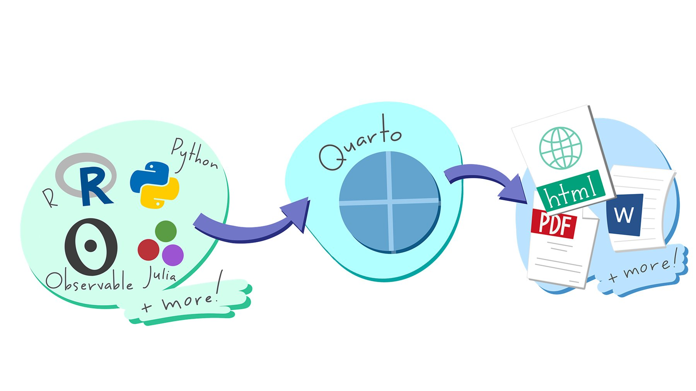
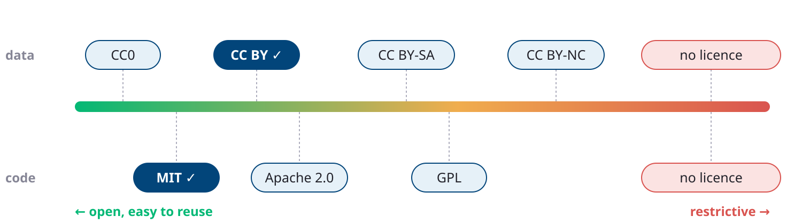
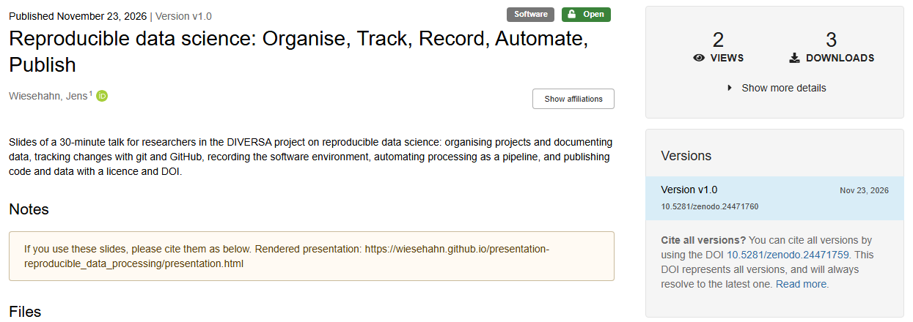

---
title-slide-attributes:
  data-background-image: images/presentation_title_image.png
  data-background-size: contain
  data-background-position: bottom
  data-background-color: "#ffffff"
  data-notes: "Welcome. • Short intro: who I am, my role in DIVERSA. • Topic: how to keep data and code work traceable and reusable. • Five steps in 30 minutes: organise, track, record, automate, publish. • No laptop needed, just follow along. • Slides are online and citable, link and QR code at the end."
nocite: |
  @Horst_artwork
---

## One change, many consequences

::: {.question}
What happens if one value changes at the very start?
:::

::: {.r-stack}
{fig-alt="A branching data pipeline from field plot data to figures, paper, web map and other subprojects" width="1500px"}

{.fragment fig-alt="The same pipeline with every step downstream of the field data highlighted in pink" width="1500px"}
:::

::: notes
- ~1.5 min.
- Imagine: one of our field plots has to be relocated, the site was too steep. Its coordinates change.
- Walk through the pipeline: field data, cleaning, plot table, then many things built on top.
- Click: everything downstream turns pink. All of it is affected.
- Ask: who already used the old coordinates? Which figures are now wrong?
- Can we even tell what changed, when, and why?
:::

## Reproducibility is a spectrum

::: {.question}
Same data + same code → same result?
:::

:::: {.columns}
::: {.column width="50%"}
Not all-or-nothing. Every step helps:

::: {.qa}
[Where is what? What does it mean?]{.q}
[→ **Organise & document**]{.a}

[What changed, when, and why?]{.q}
[→ **Version control**]{.a}

[Will it still run elsewhere?]{.q}
[→ **Record the environment**]{.a}

[What do I rerun, in which order?]{.q}
[→ **Automate**]{.a}

[Can others find, reuse and cite it?]{.q}
[→ **Publish**]{.a}
:::
:::

::: {.column width="50%"}
{fig-alt="Cartoon: a monster judge in the reproducibility court, an R Markdown document as exhibit A"}
:::
::::

::: {.attribution}
Artwork by [Allison Horst](https://allisonhorst.com), CC-BY 4.0
:::

::: notes
- ~1.5 min.
- Reproducible: the same data and the same code give the same result.
- Changing data is just one challenge. These five questions come up in every project.
- Each question has a step that answers it. These are the five parts of the talk.
- Not all-or-nothing: each step helps on its own, for colleagues and for future you.
:::


# 1 · Organise {background-color="#02457a"}

::: notes
- First step: organise the project and document it.
:::

## One project, one folder {auto-animate="true"}

::: {.question}
Which file is the current one?
:::

```{.default}
my-project/
├── plots.csv
├── plots_final.csv
├── plots_final_v3_corrected.csv
├── analysis.R
├── analysis_NEW.R
├── analysis_NEW_2.R
├── map.png
└── map_old.png
```

::: notes
- ~30 s.
- Does this look familiar? Which file is the current one?
- Ask for a show of hands: who has a file called final_v3? No shame, everyone starts here.
:::

## One project, one folder {auto-animate="true"}

::: {.question}
Which file is the current one?
:::

:::: {.columns}
::: {.column width="42%"}
```{.default}
diversa-plots/
├── README.md
├── data-raw/   # original
│   └── plots_field_2025.csv
├── data/       # from scripts
├── R/
│   ├── 01_clean_plots.R
│   ├── 02_export.R
│   └── 03_site_vars.R
├── output/     # results
└── _targets.R
```
:::

::: {.column width="58%"}
{fig-alt="Sketch: raw data kept raw, organised wrangling, open analyses, reproducible outputs, backed up with version control" .lightbox}
:::
::::

::: {.attribution}
Artwork by [Allison Horst](https://allisonhorst.com), CC-BY 4.0
:::

::: notes
- ~1 min.
- One folder per project, everything inside it.
- Separate raw data, processed data, code and results.
- data/ and output/ can be deleted at any time: the scripts recreate them.
- The sketch on the right shows the same flow: keep raw data raw, then wrangle, analyse, report.
:::

## Raw data stays untouched

::: {.question}
How do you correct an error in raw data?
:::

[Correct in code, not in the file.]{.second-color}

```{.r filename="R/01_clean_plots.R"}
plots <- read.csv("data-raw/plots_field_2025.csv")

# Plot 17 relocated: original site too steep for measurements.
# Re-measured 2026-05-12, see field protocol 42.
plots[plots$plot_id == 17, c("x", "y")] <- c(562520, 5813295)

write.csv(plots, "data/plots.csv", row.names = FALSE)
```

::: notes
- ~1 min.
- Never edit the original field file by hand.
- Read it, fix it in code, write the result to data/.
- The comment explains why: site too steep, field protocol 42.
- The correction is documented exactly where it happens.
- Same idea in Python or any other language.
:::

## Document for future you

::: {.question}
Would a new colleague understand your project?
:::

:::: {.columns}
::: {.column width="45%"}
**Document at every level**

| | |
|---|---|
| project | README |
| data | data dictionary |
| code | comments: *why*, not *what* |
| changes | commit messages |

<br>

Template & guide: [makeareadme.com](https://www.makeareadme.com)
:::

::: {.column width="55%"}
{fig-alt="Two monsters reading a climbing guide book with existing routes, warnings and notes" .lightbox}
:::
::::

::: {.attribution}
Artwork by [Allison Horst](https://allisonhorst.com) for Openscapes, CC-BY 4.0
:::

::: notes
- ~1.5 min.
- Your most important collaborator is you in six months.
- Document at four levels. The README is the entry point of every project.
- A good README covers: purpose, structure, how to run, data sources and licence, contact.
- Like a climbing guide: existing routes, warnings, notes.
- Plain text, next to the code, updated together with the code. GitHub shows it automatically.
- makeareadme.com has a template.
:::

## Describe your data

::: {.question}
What does `x` mean here, and what is `NA`?
:::

| column | description | type | unit | allowed values | missing |
|---|---|---|---|---|---|
| `plot_id` | plot identifier | integer | – | unique | – |
| `x`, `y` | plot centre | number | m, EPSG:25832 | – | `NA` |
| `forest_type` | dominant tree species | text | – | beech, spruce, oak, pine | `NA` |
| `management` | management status | text | – | managed, unmanaged | `NA` |

<br>

[A data dictionary answers questions before they are asked.]{.second-color}

::: notes
- ~1 min.
- A data dictionary describes every column.
- The usual gaps: units, coordinate system, allowed values, and how missing values are coded.
- It can live in the README or in a separate CSV file.
:::

## Relative paths, not absolute {auto-animate="true"}

::: {.question}
Does your code run on a colleague's computer?
:::

:::: {.columns}
::: {.column width="45%"}
```{.default}
C:/Users/me/Documents/
  DIVERSA/final/
  plots_final_v3_corrected.csv
```
:::

::: {.column width="55%"}
{fig-alt="A cartoon of a cracked glass cube looking frustrated with casts on its arm and leg, with bandaids on it, containing setwd, looks on at a metal riveted cube labeled R Proj holding a skateboard looking sympathetic, and a smaller cube with a helmet on labeled here doing a trick on a skateboard."}
:::
::::

::: {.attribution}
Artwork by [Allison Horst](https://allisonhorst.com), CC-BY 4.0
:::

::: notes
- ~15 s.
- This path exists on exactly one computer: mine.
- Send the script to a colleague and it breaks on the first line.
:::

## Relative paths, not absolute {auto-animate="true"}

::: {.question}
Does your code run on a colleague's computer?
:::

:::: {.columns}
::: {.column width="45%"}
```{.default}
data/plots.csv
```

- paths start at the **project folder**
- open the project as a whole: RStudio project, VS Code folder, …
- works on every computer, in any language
:::

::: {.column width="55%"}
{fig-alt="A cartoon of a cracked glass cube looking frustrated with casts on its arm and leg, with bandaids on it, containing setwd, looks on at a metal riveted cube labeled R Proj holding a skateboard looking sympathetic, and a smaller cube with a helmet on labeled here doing a trick on a skateboard."}
:::
::::

::: {.attribution}
Artwork by [Allison Horst](https://allisonhorst.com), CC-BY 4.0
:::

::: notes
- ~45 s.
- Paths start at the project folder, so they work on any computer.
- Open the whole project, e.g. as an RStudio project or a VS Code folder. That sets the starting point.
- R users: avoid setwd(). For Quarto files in subfolders, here::here() helps.
- Transition: the project is organised. Next, keep track of how it changes.
:::


# 2 · Track {background-color="#02457a"}

::: notes
- Second step: keep track of changes with version control.
:::

## Why git?

::: {.question}
Which version did I send to the other subproject?
:::

**history** · **undo** · **compare** · **why**

{.r-stretch fig-alt="Two climbing panels: with version control a clear route with commits, without it a tangle of analysis_final_final.xls files" .lightbox}

::: {.attribution}
Artwork by [Allison Horst](https://allisonhorst.com) for Openscapes, CC-BY 4.0
:::

::: notes
- ~1 min.
- git is a program on your own computer. It works offline and privately, no account needed.
- One file name, every version is stored inside git. No more final_v3.
- Four benefits: full history, undo, compare versions, and see why something changed.
- Right panel: without version control you get lost in file names.
:::

## A commit is a save point with a message

::: {.question}
What changed, when, and why?
:::

:::: {.columns}
::: {.column width="42%"}
```{.default}
a3f9c21  Move plot 17: too steep
7be01d4  Fix species codes
1c2e8f0  Add plot sites 2025
```

<br>

[You decide **when** to save and **what** to say.]{.second-color}
:::

::: {.column width="58%"}
{fig-alt="A climbing monster falls but is caught by the rope clipped into commits" .lightbox}
:::
::::

::: {.attribution}
Artwork by [Allison Horst](https://allisonhorst.com) for Openscapes, CC-BY 4.0
:::

::: notes
- ~1 min.
- A commit is a snapshot of the whole project: ID, author, date, message.
- Like protection points when climbing: if you fall, you only drop back to the last commit.
- Write messages that say why, not just "update".
:::

## See exactly what changed {auto-animate="true"}

::: {.question}
What changed, when, and why?
:::

```{=html}
<div class="diffview">
<div class="fname">data/plots.csv</div>
<div class="line" data-id="l0">  plot_id,x,y,forest_type,management</div>
<div class="line" data-id="l1">  16,561870,5813015,beech,unmanaged</div>
<div class="line" data-id="l2">  17,562455,5813410,spruce,managed</div>
<div class="line" data-id="l3">  18,563102,5812877,oak,unmanaged</div>
</div>
```

::: notes
- ~15 s.
- This is the processed plot table before the change.
:::

## See exactly what changed {auto-animate="true"}

::: {.question}
What changed, when, and why?
:::

```{=html}
<div class="diffview">
<div class="fname">data/plots.csv</div>
<div class="line" data-id="l0">  plot_id,x,y,forest_type,management</div>
<div class="line" data-id="l1">  16,561870,5813015,beech,unmanaged</div>
<div class="line del" data-id="l2">- 17,562455,5813410,spruce,managed</div>
<div class="line add" data-id="l2b">+ 17,562520,5813295,spruce,managed</div>
<div class="line" data-id="l3">  18,563102,5812877,oak,unmanaged</div>
</div>
```

<br>

`a3f9c21` · Jens · 2026-05-12 · *Move plot 17: original site too steep*

::: notes
- ~1 min.
- After rerunning the script, git shows exactly what changed: old line in pink, new line in green.
- Plus who, when and why, from the commit.
- This answers the question from the opening.
- Works for code and text data like CSV or GeoJSON, not for Excel or other binary files.
:::

## Why add a remote?

::: {.question}
What if your laptop dies tomorrow?
:::

:::: {.columns}
::: {.column width="42%"}
git works locally, a remote is **optional**.

::: {.fragment fragment-index=1}
- **backup**: off your laptop
:::

::: {.fragment fragment-index=2}
- **collaboration**: one shared history
:::

::: {.fragment fragment-index=3}
- **sharing**: one link for everything
:::

<br>

 **private**: only you, or your team

 **public**: open, route to publication

<br>

 GitHub ·  [GitLab](https://git.nw-fva.de) ·  [Codeberg](https://codeberg.org)
:::

::: {.column width="58%"}
::: {.r-stack}
{fig-alt="A bunny and a mouse, both looking stressed and sweaty, look on at a smoking laptop as flames start to grow from it. Text reads: plan on it."}

{.fragment fragment-index=2 fig-alt="A row of 6 cute smiling monsters celebrating using GitHub. The first, wearing a climbing harness labeled Me, is high-fiving another whose harness says Future Me. Others hold a box of snacks that are tacos, a map, and a rope. Text above the monsters quotes Jenny Bryan: Collaboration is the most compelling reason to manage a project with Git and GitHub. My definition of collaboration includes hands-on participation by multiple people, including your past and future self, as well as an asymmetric model, in which some people are active makers and others only read or review."}
:::
:::
::::

::: {.attribution}
Artwork by [Allison Horst](https://allisonhorst.com) (partly for Openscapes), CC-BY 4.0
:::

::: notes
- ~1.5 min.
- git alone works on your computer. A remote is a copy online.
- Click 1, backup: laptops die. Plan on it.
- Click 2, collaboration: one shared history. That includes your past and future self.
- Click 3, sharing: one link to the whole project.
- Start private if unsure. Make it public when you publish.
- Hosts: GitHub is the most widespread and used here. Institutional GitLab is often not accessible to external partners. Codeberg is non-profit and EU-based. git is the same everywhere, so switching is easy.
- Keep large or sensitive files out of git with .gitignore, e.g. audio recordings or passwords.
:::

## The daily loop

::: {.question}
How does a change get from my folder to GitHub?
:::

{fig-alt="Diagram: working folder, add, staging area, commit, local repository, push, remote repository, pull back to working folder" width="1500px"}

[In RStudio and VS Code these are buttons.]{.second-color}

::: notes
- ~1.5 min.
- Point at each box from left to right.
- add: choose which changes go into the next save point.
- commit: save them with a message, in the local history.
- push: upload to GitHub. pull: get your colleagues' changes.
- Without a remote it is only add and commit, all local.
:::

## No terminal needed

::: {.question}
Do I need the command line?
:::

:::: {.columns}
::: {.column width="40%"}
VS Code, Source Control view:

1. **+** stages a changed file
2. write a message
3. **Commit**
4. **Sync** = pull + push

<br>

RStudio: same in the *Git* pane.
:::

::: {.column width="60%"}
{fig-alt="VS Code Source Control view with a commit message box, Commit button, staged changes and the Stage Changes button" width="100%" .lightbox}
:::
::::

::: {.attribution}
Screenshot: [VS Code docs](https://code.visualstudio.com/docs/sourcecontrol/staging-commits), CC BY 3.0 US
:::

::: notes
- ~1 min.
- No command line needed. Editors have git built in.
- The plus button is add, the Commit button is commit, Sync is pull and push.
- RStudio has the same in its Git pane.
- For the first setup: Happy Git and GitHub for the useR, link at the end.
- If time at the end: live walkthrough of a real repository (backup slide).
- Transition: the history is safe. But will the code still run?
:::


# 3 · Record {background-color="#02457a"}

::: notes
- Third step: record the software environment.
:::

## "Works on my machine"

::: {.question}
Will your code still run next year?
:::

[Package versions change, and results with them.]{.second-color}

:::: {.columns}
::: {.column width="50%"}
::: {.incremental}
- **minimum**: list software and package versions in the README
- **R**: `renv::snapshot()` writes the lock file, `renv::restore()` rebuilds it
- commit `renv.lock` to git
- **this presentation**: Quarto version pinned in the workflow
:::
:::

::: {.column width="50%"}
```{.json filename="renv.lock (excerpt)"}
{
  "R": { "Version": "4.4.1" },
  "Packages": {
    "sf": {
      "Version": "1.0-16"
    },
    "targets": {
      "Version": "1.7.1"
    }
  }
}
```
:::
::::

::: notes
- ~2 min.
- Packages get updated. Functions change, defaults change, results can change.
- Minimum: write down the versions you used.
- Better in R: renv records the exact versions in a lock file, like the one on the right.
- A colleague runs renv::restore() and gets the same versions.
- Same idea in Python: requirements.txt or environment.yml.
- Containers like Docker go one step further. Most projects do not need them.
:::


# 4 · Automate {background-color="#02457a"}

::: notes
- Fourth step: automate the processing.
:::

## What do I rerun?

::: {.question}
Which scripts do I need to rerun after a change?
:::

{fig-alt="The pipeline with every step downstream of the field data highlighted" width="1500px"}

::: notes
- ~1 min.
- Back to the opening picture: plot 17 moved, every pink box is outdated.
- Rerunning all of this by hand means forgetting a step sooner or later.
:::

## Write the pipeline down

::: {.question}
Who knows the order of the steps?
:::

:::: {.columns}
::: {.column width="40%"}
**Script list**

```{.r filename="run_all.R"}
source("R/01_clean_plots.R")
source("R/02_read_soil.R")
source("R/03_diversity.R")
source("R/04_model.R")
```

*You* keep the order, everything reruns.
:::

::: {.column width="60%"}
**Pipeline**

```{.r filename="_targets.R"}
list(
  tar_target(plots, clean(raw)),
  tar_target(soil, read_soil(f)),
  tar_target(div, calc_div(plots, soil)),
  tar_target(model, fit(div))
)
```

The tool knows the order, only changes rerun.
:::
::::

`targets::tar_make()` · [same idea in other languages: Make, Snakemake]{.third-color}

::: notes
- ~1.5 min.
- Simple start: one script that runs all others in order. Better than nothing.
- But you must keep the order yourself, and everything reruns every time.
- Pipeline: each step names its inputs. Example: diversity needs plots and soil.
- So the tool knows the order. One command, tar_make(), runs it all.
- Other languages have the same idea: Make, Snakemake.
:::

## Only rerun what changed

::: {.question}
Do I have to rerun everything?
:::

{fig-alt="Pipeline where soil data changed: only diversity indices, models, figures, paper and other subprojects are rerun, all other steps are skipped" width="1500px"}

::: {.legend}
[]{.box style="background:#f10087;border-color:#f10087"} changed [ ]{.box style="background:#fde3f0;border-color:#f10087"} rerun [ ]{.box style="background:#f3f3f6;border-color:#adadbd"} up to date, skipped
:::

::: notes
- ~1 min.
- The pipeline remembers what it already built.
- Here only the soil data changed. Only the steps downstream of it run again.
- Everything grey is skipped. For slow models this saves hours.
:::

## From script to report

::: {.question}
How do figures and numbers get into your paper?
:::

:::: {.columns}
::: {.column width="50%"}
**Copy & paste**

Figures and numbers copied into Word. Works, but every change means updating each copy by hand.

**One document**

Text, code and results in one file:

```{=html}
<!-- raw HTML with escaped backticks, so Quarto does not execute the example -->
<div class="code-with-filename">
<div class="code-with-filename-file"><pre><strong>report.qmd</strong></pre></div>
<div class="sourceCode"><pre class="sourceCode"><code>We sampled &#96;{r} n&#96; plots.

&#96;&#96;&#96;{r}
#| fig-cap: Plot locations
plot(plots$x, plots$y)
&#96;&#96;&#96;</code></pre></div>
</div>
```

[Render → text, numbers and figures update together.]{.second-color}
:::

::: {.column width="50%"}
{fig-alt="A schematic representing the multi-language input (e.g. Python, R, Observable, Julia) and multi-format output (e.g. PDF, html, Word documents, and more) versatility of Quarto."}

These slides are made this way too.
:::
::::

::: {.attribution}
Artwork by [Allison Horst](https://allisonhorst.com), CC-BY 4.0
:::

::: notes
- ~1 min.
- Two ways to get results into a paper.
- Copy & paste: save the figure, paste it into Word, type the numbers. Fine for a one-off report.
- When data or analyses change, every copy must be updated by hand, and something may get missed.
- One document: text, code and results together. Rendering runs the code, so numbers and figures stay current.
- Quarto works with R, Python and more, and renders to HTML, PDF or Word, so co-authors can still comment in Word.
- These slides are a Quarto document as well.
- Transition: the work is reproducible. Now let others use it.
:::


# 5 · Publish {background-color="#02457a"}

::: notes
- Fifth step: publish, so others can find, reuse and cite the work.
:::

## FAIR in one slide

::: {.question}
What makes data and code reusable?
:::

| | | |
|---|---|---|
| **F**indable | DOI, metadata | Zenodo record |
| **A**ccessible | open, standard protocol | public repository |
| **I**nteroperable | open formats, vocabularies | CSV, GeoPackage |
| **R**eusable | licence, documentation | README, data dictionary |

::: notes
- ~1 min. Keep it short if the earlier talks already covered FAIR.
- Most of this follows from the earlier steps: README, data dictionary, open formats.
- What is still missing: a licence and a DOI. That comes next.
:::

## No licence, no reuse

::: {.question}
May others reuse your code and data?
:::

{fig-alt="Licence spectrum from open to restrictive. Data: CC0, CC BY (recommended), CC BY-SA, CC BY-NC, no licence. Code: MIT (recommended), Apache 2.0, GPL, no licence." width="1500px"}

[No licence → unclear rights → no safe reuse.]{.second-color} Help choosing: [choosealicense.com](https://choosealicense.com)

::: notes
- ~1 min.
- Code is protected by copyright automatically. Without a licence, others may look at it but not legally reuse it, even in a public repository.
- For data it is less clear: plain facts are often not protected, but databases can be. Unclear rights mean nobody can reuse it safely.
- Left is open and easy to reuse, right is restrictive.
- Recommendation: MIT for code, CC BY for data. Both only ask for credit.
- Add a LICENSE file to the project. choosealicense.com helps.
:::

## Get a DOI, cite a version

::: {.question}
How do others cite your work?
:::

:::: {.columns}
::: {.column width="42%"}
1. connect GitHub to [Zenodo](https://zenodo.org) (once)
2. create a release on GitHub (`v1.0`)
3. Zenodo archives it and mints a DOI

| | resolves to |
|---|---|
| **version DOI** | exactly this release |
| **concept DOI** | always the latest |

`CITATION.cff` → **Cite this repository** button on GitHub
:::

::: {.column width="58%"}
[{fig-alt="Zenodo record of this presentation, version v1.0, with title, author, abstract and the versions box showing the version DOI and the concept DOI" width="100%"}](https://doi.org/10.5281/zenodo.24471760)

[This presentation on Zenodo · version DOI [10.5281/zenodo.24471760](https://doi.org/10.5281/zenodo.24471760) · concept DOI [10.5281/zenodo.24471759](https://doi.org/10.5281/zenodo.24471759)]{style="font-size: 0.65em;"}
:::
::::

::: notes
- ~2 min.
- Zenodo is run by CERN. It is free and archives long-term.
- Three steps: connect once, create a release, get a DOI. A DOI makes code citable like a paper.
- Right: the real record of these slides, release v1.0 on GitHub archived on Zenodo.
- Every release gets its own version DOI. Cite it when your results depend on exactly that state, e.g. the plot table before plot 17 was moved.
- The concept DOI stands for the project in general and always points to the newest release.
- A CITATION.cff file adds a "Cite this repository" button on GitHub. Zenodo takes its metadata from there too.
:::


# Back to the start {background-color="#02457a"}

::: notes
- Let's put it all together.
:::

## One folder, all steps

::: {.question}
What does a reproducible project look like?
:::

```{.default}
diversa-plots/
├── README.md       ← organise
├── data-raw/       ← organise
├── R/              ← organise
├── .git/           ← track
├── renv.lock       ← record
├── _targets.R      ← automate
├── report.qmd      ← automate
├── LICENSE         ← publish
└── CITATION.cff    ← publish → DOI
```

[Code, data, environment and report in one citable package: a **research compendium**.]{.second-color}

::: notes
- ~1 min.
- All five steps end up as files in one project folder.
- Point at each line: README and folders organise, .git tracks, renv.lock records, the pipeline and report automate, LICENSE and CITATION publish.
- Such a folder is called a research compendium: everything needed to reproduce the work, citable as one package.
:::

## Back to the start

::: {.question}
What happens if one value changes at the very start?
:::

::: {.incremental}
- **what** changed → diff
- **why** → commit message
- **rerun** → pipeline
- **cite** → version DOI
:::

::: notes
- ~1 min.
- Back to plot 17 from the beginning.
- Each click answers one of the opening questions.
- What changed: the diff. Why: the commit message. What to rerun: the pipeline. Which version: the DOI.
:::

## Start small

::: {.question}
Where do I start?
:::

| step | try this |
|---|---|
| 1 · Organise | write a README |
| 2 · Track | `git init` + a GitHub repository |
| 3 · Record | note your package versions |
| 4 · Automate | describe your steps as a pipeline |
| 5 · Publish | a release on Zenodo |

::: notes
- ~1 min.
- Not everything at once.
- Pick one step that fits your current project, and do it this month.
- The README is the easiest start.
:::

## Learn more

- [The Turing Way](https://the-turing-way.netlify.app) [@TuringWay_2022]
- [Happy Git and GitHub for the useR](https://happygitwithr.com) [@Bryan_HappyGit]
- [GitHub Skills](https://learn.github.com/skills): interactive git & GitHub courses
- [Quarto: get started with RStudio](https://quarto.org/docs/get-started/computations/rstudio)
- [targets manual](https://books.ropensci.org/targets/)

::: notes
- ~30 s.
- You are not alone: lots of good material and people to ask.
- The Turing Way is the big picture. Happy Git helps with the setup. GitHub Skills has short interactive courses.
- All links are in the slides.
:::


# Thank you {visibility="uncounted"}

<br>

:::: {.columns}
::: {.column width="70%"}

Questions?

<br>

 *[](mailto:)*

 *[](https://elk.zone/fosstodon.org/@JensWiesehahn)*

:::

::: {.column width="30%"}
Slides available at:

[]()

<br>


:::
::::

::: notes
- Thank the audience.
- Point to the QR code: slides, code and DOI are all online.
- Open for questions.
:::


# References {visibility="uncounted"}

::: {#refs}
:::


# Backup: explore a real repository {visibility="uncounted"}

:::: {.columns}
::: {.column width="60%"}
[**r-spatial/sf**](https://github.com/r-spatial/sf): simple features for R

- **commits** & history
- **blame**: who changed which line
- **issues**: questions, bugs, ideas
- **pull requests**: proposed changes
- **branches** & **releases**
- **Actions**: automatic checks
:::

::: {.column width="40%"}

:::
::::

::: notes
- Backup, only if there is time.
- Switch to the browser. The audience can follow along via the QR code.
- sf is a widely used R package for spatial data, maintained on GitHub.
- Show the commit history, then blame on one file.
- Show issues and pull requests: this is how many people work together.
- Show releases and Actions briefly.
:::
